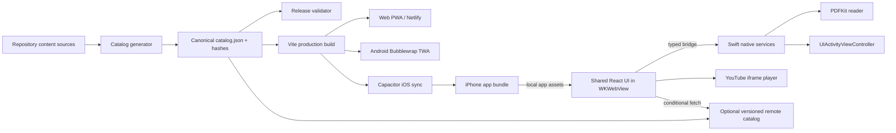
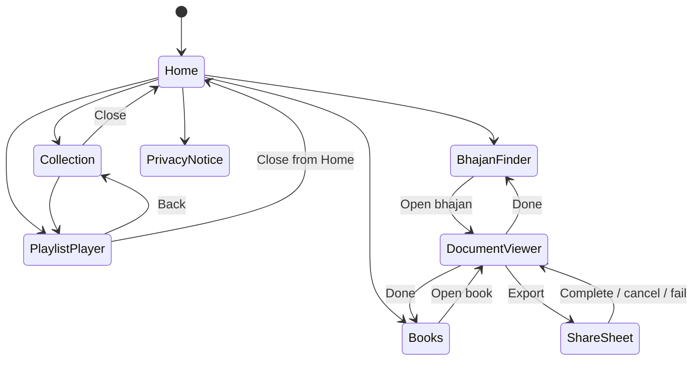

# Design Document: iPhone App Version

## Overview

The iPhone app will use **Capacitor for iOS as a thin native host around the existing React 18/Vite application**, with a small set of deliberate native integrations. Vite will continue to build one shared React content experience for the web, Android Trusted Web Activity, and iPhone. The iOS target will package the built web assets locally and run them in Capacitor's `WKWebView`; native Swift code will handle PDF reading and export, lifecycle and network signals, app metadata, and optional notification plumbing.

This is the smallest maintainable approach that preserves one catalog and one primary UI while providing enough native utility to be an app rather than a website wrapper. The native PDFKit reader, iOS share sheet, offline packaged catalog, launch screen, state restoration across native presentations, and accessibility-aware native controls provide meaningful device integration. Apple states that App Store apps should offer utility and an app-like experience beyond a repackaged website, so these capabilities are release requirements rather than optional polish ([App Review Guidelines, section 4.2](https://developer.apple.com/app-store/review/guidelines/)).

Capacitor is selected instead of a second SwiftUI product or a remote-only `WKWebView`:

- A separate SwiftUI interface would duplicate the React views, catalog models, accessibility work, and test surface.
- A remote-only web wrapper would weaken offline startup, couple launch to Netlify availability, and create App Store minimum-functionality risk.
- Capacitor packages the Vite output, exposes a JavaScript-to-Swift bridge, uses `WKWebView`, and currently supports iOS 15 and later ([Capacitor iOS documentation](https://capacitorjs.com/docs/ios)). The deployment target is therefore **iOS 15+** for the first release.

### Resolved Design Decisions

| Decision | Resolution | Rationale |
|---|---|---|
| Distribution | App Store iPhone app, while retaining the existing PWA and Android TWA | Meets the request and keeps existing channels intact. |
| Implementation | Capacitor iOS host with shared React UI and focused Swift plugins | Lowest duplication with credible native value. |
| Minimum iOS | iOS 15+ | Matches current Capacitor iOS support. |
| Offline scope | Bundle the validated catalog, UI, images, bhajan PDFs, and book PDFs; YouTube playback and uncached remote catalog updates require a network | Current documents already live in `public/`; bundling gives predictable reading and startup behavior. |
| Catalog updates | Generate one versioned catalog artifact from repository sources; package it in each app and optionally publish the same artifact for atomic runtime updates | Routine metadata additions can ship without a binary, while the last validated bundle remains available offline. |
| Notifications | Omit from the first release | Requirement 13 is conditional. No current React preference UI or content-notification backend exists. The architecture reserves a deep-link and permission boundary for a later release. |
| External links | Keep YouTube and PDF use in-app; expose system sharing for PDFs and an explicitly labeled external-open fallback only when embedded playback is unavailable | Preserves context and avoids surprise app switching. |
| iPad | Compatible execution is acceptable, but no iPad-specific layout in release one | The stated scope is iPhone. |
| Languages | Preserve bilingual Hindi-English presentation without a language selector | Matches the current product. |
| User data | No accounts, favorites, playback history synchronization, analytics, or advertising | Preserves the account-free, non-commercial product. |

### Current-System Findings That Shape the Design

- `src/App.jsx` composes one scrolling page from `Hero`, `BhajansPage`, `PlaylistSections`, `BooksSection`, and `Footer`.
- `src/data/playlists.json` stores ordered collections and standalone playlists; `src/data/playlistVideos.json` stores recorded video metadata by YouTube playlist identifier.
- `src/data/bhajanPdfs.js` stores ordered Hindi PDF filenames and English titles. `BooksSection.jsx` currently embeds book metadata in component code.
- `YouTubeLightbox.jsx` currently derives playlist identifiers from URLs and uses YouTube iframe embeds. It currently autoplays the first recorded video, which must change because Requirement 4.1 requires initial selection without playback.
- Bhajan and book PDF links currently open browser tabs or downloads. iOS requires a native document reader and system export flow.
- Vite PWA runtime caching covers the app shell and selected remote assets. The iOS app will not rely on service-worker lifecycle for its packaged shell; native builds will load local Vite assets, and explicit catalog caching will govern updates.
- The Android app uses Bubblewrap as a TWA pointed at the Netlify deployment. iOS will follow the same shared-web-product principle but package assets locally and add native integration because iOS has no direct TWA equivalent.

The design uses official guidance as current at design time. Source material has been paraphrased for licensing compliance.

## Architecture

### System Context



### Runtime Layers

1. **Shared presentation layer**: React components render Home, catalog browsing, bhajan search, collection/playlist views, player state, books, privacy, offline states, and retry controls. Responsive CSS owns Safe Area padding, Dynamic Type-compatible scaling, minimum touch sizes, focus styling, and reduced motion.
2. **Application/domain layer**: Framework-light JavaScript modules load and validate catalogs, normalize Unicode search input, reduce navigation state, associate request failures with retry tokens, and select videos. These pure modules are shared by all platforms and are the main property-based testing surface.
3. **Platform adapter layer**: Browser and Capacitor adapters implement document opening/export, network and lifecycle events, app version lookup, privacy navigation, and external-open fallback. React depends on interfaces, not on Capacitor globals.
4. **iOS native layer**: A Capacitor app target embeds the local Vite output. Focused Swift plugins present PDFKit and the share sheet, expose network/lifecycle signals and release metadata, and normalize native errors. Native code does not own catalog or UI business rules.
5. **Content/release layer**: A deterministic generator creates one canonical catalog and asset manifest. A release gate compares the generated snapshot with the packaged artifact and blocks mismatches.

### App Store Path

The release artifact is an ordinary Xcode-managed Capacitor app signed and archived for App Store Connect. It includes:

- a branded native launch storyboard and approved icon;
- local web assets so startup never depends on loading the production website;
- native PDF reading, zoom, scrolling, export, and share behavior;
- offline catalog/search/document utility;
- accurate privacy manifest and App Store privacy answers;
- review notes that explain embedded YouTube playback, offline behavior, the absence of accounts/ads, and where the in-app Privacy Notice is found.

Before each submission, the team will re-check the current [App Review Guidelines](https://developer.apple.com/app-store/review/guidelines/) because acceptance policy can change. Release automation cannot guarantee approval, but it can prevent known minimum-functionality and privacy omissions.

### Main User Flow



A cold launch always initializes `Home`, satisfying Requirement 1.1 and 12.4. State restoration applies only while the process remains alive or returns from a native presentation; it does not replace the cold-launch Home requirement.

## Components and Interfaces

### Shared React Components

#### `AppShell`

Responsibilities:

- Render the branded Home Screen and top-level sections.
- Apply `env(safe-area-inset-*)` padding at the fixed navigation bar and bottom actions.
- Own the `NavigationCoordinator`, request registry, active catalog, and platform adapter.
- Provide the Privacy Notice control and global online/offline status without blocking local content.

Requirements: 1.1-1.7, 8.3-8.4, 9.1-9.8, 10.1-10.10, 11.1-11.5, 12.4-12.5.

#### `CatalogProvider`

Responsibilities:

- Load and schema-check the packaged canonical catalog synchronously at startup.
- Optionally check a version endpoint after Home becomes interactive.
- Accept a remote catalog only after complete download, schema validation, asset-reference validation, version monotonicity, and integrity verification.
- Atomically replace the active cached remote version. Keep the packaged version and last-known-good remote version available for fallback.
- Expose immutable ordered selectors for collections, playlists, videos, bhajans, and books.

Requirements: 2.1-2.9, 3.1-3.8, 4.1-4.4, 5.1-5.10, 7.1-7.2, 8.3-8.4.

#### `NavigationCoordinator`

A reducer-driven stack replaces lightbox-only navigation. Each entry contains a typed route and a scroll snapshot. Opening a collection, player, document, privacy screen, or external fallback pushes a route. Closing or going back pops exactly one route and restores the saved scroll position after the prior view has rendered.

```ts
interface NavigationEntry {
  route: AppRoute
  scroll: { x: number; y: number }
  focusTargetId?: string
}

type AppRoute =
  | { kind: 'home'; anchor?: string }
  | { kind: 'collection'; collectionId: string }
  | { kind: 'playlist'; playlistId: string; collectionId?: string; selectedVideoId?: string }
  | { kind: 'privacy' }
```

The currently presented native document is tracked as a child presentation of the originating route, not as a replacement for the route. Returning from PDFKit therefore preserves collection/search state and scroll.

Requirements: 3.2-3.10, 6.1-6.8, 7.3-7.8, 13.8 (reserved).

#### `CollectionBrowser`

Responsibilities:

- Render catalog collections and exact recorded metadata.
- Open a dedicated collection route rather than expanding the card in place.
- Render a named empty state or named request error with scoped retry.
- Render assigned playlists in canonical order.

Requirements: 3.1-3.5, 3.8-3.10.

#### `VideoPlayer`

Responsibilities:

- Resolve a playlist by stable catalog ID.
- Select the first recorded video without loading an autoplaying player.
- On explicit playback, instantiate or command the YouTube IFrame Player API and start a five-second deadline.
- Render exactly one `aria-selected="true"` video in a listbox-style playlist.
- Use recorded video metadata when present. If absent, use the recorded YouTube playlist identifier. If neither exists, render the named unavailable state.
- Preserve selected video and best-known playback time through full-screen transitions.
- Associate retry only with the failed playback request.

The five-second requirement is measured from a user playback action until the player reports a playing state. YouTube network or policy failures produce a local error state; the app does not claim that a third-party service can always meet the deadline.

Requirements: 4.1-4.13, 8.1-8.7, 10.2.

#### `BhajanFinder`

Responsibilities:

- Render the first five distinct bhajans by canonical order when no valid query is active.
- Normalize by trimming leading/trailing Unicode whitespace and count Unicode code points, not UTF-16 units.
- Reject more than 200 Unicode characters before search.
- Match a Unicode case-folded query as a contiguous substring of Hindi or English title.
- Preserve source order and remove duplicate document IDs without sorting.
- Open or export through `DocumentService` rather than raw links.

Requirements: 5.1-5.13, 6.1-6.8.

#### `BooksBrowser`

Responsibilities:

- Render canonical book metadata in canonical order.
- Open a selected book through `DocumentService`.
- Bind a failed-open retry token to the same book ID.

Requirements: 7.1-7.8.

#### `PrivacyNotice`

The in-app notice is generated from a maintained privacy inventory and names YouTube/Google and Netlify, their purposes, data categories, recipients, and retention or retention-determination rules. It distinguishes app-controlled processing from third-party processing and links to third-party policies. The Android-specific TWA wording in the current `PRIVACY_POLICY.md` cannot be reused unchanged.

Apple requires App Store Connect privacy answers to account for data collected by the developer and third-party partners and to remain accurate as practices change ([App Privacy Details](https://developer.apple.com/app-store/app-privacy-details/)). Apple also requires submission-time privacy information and describes privacy manifests for third-party code ([User Privacy and Data Use](https://developer.apple.com/app-store/user-privacy-and-data-use/)). The release checklist therefore compares the in-app notice, iOS privacy manifest, SDK inventory, and App Store Connect answers.

Requirements: 11.5-11.12.

### Domain Services

```ts
interface CatalogRepository {
  loadPackaged(): Promise<Catalog>
  loadLastKnownGood(): Promise<Catalog | null>
  checkForUpdate(signal: AbortSignal): Promise<CatalogUpdateResult>
}

interface DocumentService {
  open(request: DocumentRequest): Promise<DocumentSession>
  export(sessionId: string): Promise<'completed' | 'cancelled'>
  close(sessionId: string): Promise<void>
}

interface NetworkService {
  currentStatus(): Promise<'online' | 'offline' | 'unknown'>
  subscribe(listener: (status: NetworkStatus) => void): Unsubscribe
}

interface AppMetadataService {
  getVersion(): Promise<string>
  getPlatform(): 'web' | 'android' | 'ios'
}

interface ExternalMediaService {
  prepare(request: PlaybackRequest): Promise<PlayerHandle>
  retry(requestId: string): Promise<PlayerHandle>
}
```

All IDs and paths crossing the bridge are resolved against the active catalog. JavaScript may not send arbitrary file paths or URLs to native services.

### iOS Native Components

#### `DocumentPlugin` and `DocumentViewController`

A custom Capacitor plugin resolves a catalog document ID to an allowlisted file packaged under app assets or downloaded by `CatalogAssetStore`. It presents a native `PDFView` inside a `UIViewController` with:

- vertical continuous page display in ascending PDF order;
- first-page initial position;
- backward and forward scrolling;
- pinch and accessibility zoom clamped to 1.0-5.0 for bhajans and 1.0-3.0 for books;
- a 44-point minimum Done control and Export control;
- a title from canonical metadata;
- VoiceOver labels, traits, and logical control order.

The plugin rejects traversal, unknown IDs, non-PDF MIME types, invalid files, and files outside its allowlisted roots.

#### `SharePlugin`

The plugin presents `UIActivityViewController` for the exact local PDF URL. Cancellation resolves as `cancelled`, not an error. Presentation or activity failures return a typed error while leaving `DocumentViewController` visible. The originating document session remains valid for retry.

#### `LifecycleNetworkPlugin`

This adapter exposes foreground/background transitions and current network-path status. Network status is advisory: requests still handle actual failures because reachability does not guarantee service availability. On foregrounding, it refreshes network state and, if notifications are added later, permission state.

#### Native App Shell

The Xcode target owns bundle identifier, `CFBundleShortVersionString`, build number, app display name `Bhaavamrit`, launch storyboard, orientation, approved app icons, supported iPhone device family, privacy manifest, and only the entitlements used by shipped features. Release one does not include notification entitlement or prompt.

### Browser and Android Adapters

The shared interfaces retain browser implementations:

- PDF open uses a same-origin browser tab and download uses the browser's save behavior.
- Network status uses browser events plus request outcomes.
- App version comes from generated build metadata.

The Android TWA remains unchanged in architecture. Shared-domain refactoring must preserve its current URLs and behavior.

## Data Models

### Canonical Catalog

The repository will have one generated, versioned JSON representation. Existing sources remain authoring inputs initially, including `playlists.json`, `playlistVideos.json`, `bhajanPdfs.js`, static book metadata currently in `BooksSection.jsx`, and relevant `public/` assets. Moving book metadata into a data module is an implementation task, not part of this design change.

```ts
interface CatalogEnvelope {
  schemaVersion: 1
  catalogVersion: string
  generatedAt: string
  sourceRevision: string
  contentHash: string
  collections: CollectionRecord[]
  standalonePlaylists: PlaylistRecord[]
  bhajans: BhajanRecord[]
  books: BookRecord[]
  assets: AssetRecord[]
}

interface CollectionRecord {
  id: string
  title: string
  thumbnail: AssetRef
  playlistIds: string[] // canonical order
}

interface PlaylistRecord {
  id: string
  title: string
  thumbnail: AssetRef
  youtubePlaylistId?: string
  collectionId?: string
  videos?: VideoRecord[] // canonical order when recorded
}

interface VideoRecord {
  id: string
  title: string
  thumbnail: AssetRef
}

interface BhajanRecord {
  id: string
  hindiTitle: string
  englishTitle: string
  meaning?: string
  document: AssetRef
}

interface BookRecord {
  id: string
  title: string
  subtitle?: string
  author?: string
  pageCount: number
  cover: AssetRef
  document: AssetRef
}

interface AssetRecord {
  id: string
  path: string
  sha256: string
  byteLength: number
  mediaType: string
  availability: 'packaged' | 'remote'
}
```

Arrays carry display order. Consumers must not sort catalog arrays. Stable string IDs, not array offsets, identify records.

### Snapshot and Comparison Models

```ts
interface ValidationSnapshot {
  snapshotId: string
  startedAt: string
  sourceRevision: string
  catalog: CatalogEnvelope
  sourceFiles: SourceDigest[]
}

interface CatalogDiff {
  scope: 'collection' | 'playlist' | 'video' | 'bhajan' | 'book' | 'asset'
  id?: string
  field?: string
  expected?: unknown
  actual?: unknown
  reason: 'missing' | 'additional' | 'order' | 'membership' | 'metadata' | 'unreadable'
}
```

At the start of one validation run, the generator reads all source inputs once and materializes an immutable snapshot. Both the packaged `catalog.json` and comparison expected values derive from that snapshot. Comparison is exact for strings, IDs, order, membership, and asset references. It ignores only the runtime fields excluded by Requirement 2.5. Any read failure, generation failure, duplicate stable ID, missing asset, hash mismatch, or non-empty diff fails the release and reports the affected scope.

### Runtime State

```ts
interface AppState {
  catalog: CatalogState
  navigation: NavigationEntry[]
  bhajanFinder: { rawQuery: string; showAll: boolean }
  player?: {
    playlistId: string
    selectedVideoId?: string
    playbackState: 'idle' | 'loading' | 'playing' | 'paused' | 'failed'
    positionSeconds?: number
  }
  requests: Record<string, RequestState>
  network: NetworkStatus
}

interface RequestState {
  requestId: string
  kind: 'catalog-update' | 'thumbnail' | 'playback' | 'document-open' | 'document-export'
  targetId: string
  status: 'pending' | 'failed' | 'retryable' | 'succeeded'
  errorCode?: string
}
```

Request IDs make retries local: retrying one failed request cannot replay other requests. UI state and playback position are not written into the canonical catalog. The navigation stack and scroll snapshots may be held in memory while active, but a terminated-state launch discards them and starts at Home.

### Remote Catalog Update Protocol

1. Home renders from the packaged or newer last-known-good catalog.
2. After first interaction is available, the app requests a small version descriptor over HTTPS.
3. If newer, it downloads the complete catalog and any remote assets to a staging directory.
4. It validates schema, unique IDs, references, declared hashes, HTTPS/allowlisted hosts, and complete assets needed for activation.
5. It atomically marks the new catalog active. Partial updates never become visible.
6. Failure leaves the current catalog active and creates a retryable request state.
7. Cache pruning never deletes the packaged fallback or assets used by the active version.

This protocol permits routine updates without an App Store release while ensuring Requirement 2 release parity for every submitted binary.

## Correctness Properties

*A property is a characteristic or behavior that should hold true across all valid executions of a system-essentially, a formal statement about what the system should do. Properties serve as the bridge between human-readable specifications and machine-verifiable correctness guarantees.*

The properties below cover pure repository, catalog, search, navigation, request-state, privacy-inventory, and release-version logic. The reflection performed after acceptance-criteria prework consolidated overlapping field, count, and restoration checks so each property adds distinct validation value.

### Property 1: Snapshot projection is complete and stable

For all valid Current Content Source models, snapshot generation shall record every catalog item, membership sequence, display sequence, source-provided metadata value, identifier, and asset reference exactly once in the applicable canonical location; changing only excluded runtime state shall not change the generated catalog projection.

**Validates: Requirements 2.1, 2.2, 2.3, 2.4, 2.5**

### Property 2: Exact catalog comparison accepts only parity

For all validation snapshots and candidate packaged catalogs, comparison shall succeed if and only if their included items, memberships, orders, metadata values, identifiers, and asset references are exactly equal; every generated missing, additional, reordered, reassigned, or changed value shall produce a release-blocking diff in its affected scope.

**Validates: Requirements 2.6, 2.7, 2.8**

### Property 3: Catalog views preserve canonical content

For all valid catalogs and all collection, playlist, video, bhajan, and book records selected for display, the view model shall preserve the canonical records' order and exact applicable titles, thumbnails, covers, subtitles, authors, page counts, meanings, and counts without sorting, rewriting, or dropping values.

**Validates: Requirements 3.1, 3.2, 3.5, 4.2, 4.3, 4.4, 5.9, 5.10, 7.1, 7.2**

### Property 4: Navigation push and pop restore the predecessor

For all valid nonempty navigation stacks, all openable collection or playlist targets, and all nonnegative scroll positions, pushing a target and then popping it shall restore the exact preceding route, scroll position, and focus target; a playlist opened from a collection shall retain that collection as its predecessor.

**Validates: Requirements 3.6, 3.7, 3.9, 3.10**

### Property 5: Unavailable playlists do not replace their origin

For all originating content routes and playlist IDs, if playlist availability resolution fails, the resulting state shall preserve the origin route and its scroll snapshot and shall associate the visible unavailable state with exactly the selected playlist ID.

**Validates: Requirements 3.8**

### Property 6: Player initialization chooses one deterministic mode

For all valid playlist records, player initialization shall select the first recorded video with playback idle when a nonempty recorded video list exists; otherwise it shall choose playlist-embed mode when a valid playlist identifier exists, and unavailable mode when neither source exists.

**Validates: Requirements 4.1, 4.9, 4.13**

### Property 7: Video selection remains singular

For all nonempty recorded video lists, all valid current selections, and all valid newly selected video IDs, applying the selection action shall result in the chosen ID being selected and every other video ID being unselected.

**Validates: Requirements 4.5, 4.6**

### Property 8: Search matches the reference Unicode model

For all catalogs of bhajan records and all trimmed queries containing 1 through 200 Unicode code points, the search result shall equal the stable distinct sequence of records whose Unicode case-folded Hindi title or English title contains the case-folded query as a contiguous substring, and the reported result count shall equal that sequence's length.

**Validates: Requirements 5.3, 5.4, 5.5, 5.6**

### Property 9: Empty search state is a stable distinct prefix

For all catalogs of bhajan records and all raw queries that become empty after Unicode trimming, opening, clearing, or submitting that query shall produce the first at most five distinct records in canonical order and shall report the total distinct catalog count; requesting all shall produce every distinct record in canonical order.

**Validates: Requirements 5.1, 5.2, 5.8, 5.12, 5.13**

### Property 10: Oversized search never executes

For all raw queries whose trimmed value contains more than 200 Unicode code points, submission shall produce the 200-character validation state and shall produce no search execution command.

**Validates: Requirements 5.11**

### Property 11: Request retries are isolated and stable

For all request registries containing any number of pending, failed, retryable, and successful requests, retrying one retryable request shall issue exactly one command for that request's kind and target ID, shall not issue or mutate any other request, and, if it fails again, shall preserve local catalog/navigation state and the same target association.

**Validates: Requirements 7.8, 8.2, 8.6, 8.7**

### Property 12: Privacy notice covers the processing inventory

For all valid release privacy inventories, every declared external service and every processed data category shall have exactly one corresponding notice entry with a nonempty service name where applicable, purpose, recipient, and retention period or retention-determination rule; no inventory entry may be omitted.

**Validates: Requirements 11.6, 11.7, 11.8, 11.9, 11.10**

### Property 13: Release version validation is bounded and unique

For all proposed release identifiers and sets of previously distributed identifiers, validation shall accept the proposal if and only if it is nonempty, contains at most 64 characters, and is absent from the previously distributed set.

**Validates: Requirements 12.6, 12.7**

## Error Handling

### Error Principles

- Preserve locally available catalog, navigation, and documents whenever a network or third-party operation fails.
- Name the failed content using canonical metadata. Do not expose raw URLs, filesystem paths, stack traces, or third-party payloads.
- Bind each retry control to one immutable `requestId` and `targetId`.
- Treat cancellation as a successful user outcome distinct from failure.
- Put an accessible status message adjacent to the affected operation and move VoiceOver focus only when needed to announce a blocking error.
- Log only coarse diagnostic codes locally. Release one sends no analytics or diagnostics off device.

### Error Taxonomy

| Code | Condition | User behavior | Recovery |
|---|---|---|---|
| `CATALOG_PACKAGED_INVALID` | Bundled catalog cannot be decoded or violates schema | Show a blocking local-content error naming the unavailable scope | Release-blocking in production validation; no unsafe remote fallback |
| `CATALOG_UPDATE_OFFLINE` | Update check attempted offline | Keep packaged/last-known-good catalog visible; identify online requirement only near update-dependent content | Enable same retry after network returns |
| `CATALOG_UPDATE_INVALID` | Remote catalog/hash/reference validation fails | Keep current catalog; do not expose partial update | Retry request or await a corrected published version |
| `COLLECTION_UNAVAILABLE` | Selected collection cannot resolve | Keep origin visible; name collection and show retry | Retry only collection resolution |
| `PLAYLIST_UNAVAILABLE` | Playlist lacks usable metadata/identifier or cannot resolve | Keep origin or show named player unavailable state as specified | Retry only selected playlist when meaningful |
| `PLAYBACK_OFFLINE` | Playback requested without network | Name selected video/playlist and state that a connection is required | Enable request-specific retry on reconnection |
| `PLAYBACK_TIMEOUT` | No playing event within five seconds | Name selected video and show retry | Dispose stale player command before retry |
| `PLAYBACK_SERVICE_ERROR` | YouTube reports an error | Preserve selection/list; show retry and optional labeled external-open fallback | Retry selected item only |
| `DOCUMENT_NOT_FOUND` | Catalog document asset is absent | Keep origin screen; name Hindi bhajan title or book title | Retry same catalog ID |
| `DOCUMENT_INVALID` | PDFKit cannot parse document | Keep origin screen; name document and show retry | Retry after re-resolution; do not share invalid bytes |
| `EXPORT_CANCELLED` | User dismisses share sheet | Return to the same open page and zoom state; no error | None |
| `EXPORT_FAILED` | Share controller cannot present or complete | Keep PDF open; announce error and show retry | Retry same document session |
| `BRIDGE_UNAVAILABLE` | Native API called outside iOS or plugin fails to register | Use browser adapter on web; on iOS show scoped unavailable state | Release test must catch plugin registration errors |
| `PERMISSION_DENIED` | Future permission-backed feature is denied | Explain only the affected feature; preserve all unrelated features | Open Settings only from an explicit user action |

Release validation errors are fail-closed. Runtime remote-update errors are fail-safe by retaining a complete prior catalog.

## Testing Strategy

### Test Layers

#### Pure unit tests

Use Vitest (added during implementation) for catalog projection, schema validation, Unicode query handling, stable deduplication, player-mode resolution, navigation reduction, request isolation, privacy-inventory checks, and release-version validation. Example tests cover fixed bilingual copy, named empty/error states, exact five-second timer transitions with fake clocks, and cancellation semantics.

#### Property-based tests

Use **fast-check** with Vitest for the thirteen correctness properties. Each property test shall:

- run at least 100 generated cases (`numRuns >= 100`);
- use generators that include empty collections, duplicate records, long and combining Unicode text, Devanagari, case variants, reordered arrays, missing optional fields, concurrent requests, and nested navigation stacks;
- shrink failures to a reproducible counterexample;
- implement one design property per property test;
- include a comment in this exact format: `Feature: iphone-app-version, Property N: <property text>`;
- test pure adapters/fakes rather than making YouTube, filesystem, App Store, or network calls.

Property tests complement rather than replace examples. Integration behavior, platform configuration, visual rendering, and third-party services are not suitable for repeated randomized calls.

#### React component and browser tests

Use React Testing Library for roles, headings, accessible names, selected state, search feedback, and retry ownership. Use Playwright, already present in the repository, for shared PWA regression tests at 320x568, 375x667, 390x844, 430x932, and 440x956 CSS-pixel portrait viewports. Checks include scroll reachability, visible touch affordances, responsive overflow, keyboard focus, reduced motion, and route/scroll restoration.

#### Native unit and integration tests

Use XCTest for:

- catalog-ID-to-file allowlisting and path traversal rejection;
- PDF session creation and zoom-range configuration;
- share completion/cancellation/failure mapping;
- app metadata and version exposure;
- notification permission mapping only if Requirement 13 is included later.

Use XCUITest on supported simulator sizes and at least one physical iPhone to verify cold launch, native launch screen timing, Safe Area geometry, 44-by-44-point targets, PDF first page, continuous scrolling, zoom bounds, share sheet, cancellation, return-state restoration, offline startup, reconnection, and one-action-per-tap behavior.

#### Accessibility and visual tests

- Run automated accessibility checks against React semantics and native screens.
- Test every standard Dynamic Type category from Extra Small through Accessibility Extra Extra Extra Large. The web layer maps `font: -apple-system-body`/scalable root tokens where appropriate and must not cap user scaling.
- Inspect VoiceOver reading order, names, headings, selected video state, PDF controls, and error announcements manually on device.
- Measure text and essential graphical contrast against Requirements 10.7-10.9.
- Run screenshot comparisons at viewport and Dynamic Type boundaries.
- Enable Reduce Motion and verify spatial keyframes/transitions are removed in both CSS and native presentations.

#### External-service integration tests

Use a small, stable test playlist and representative production playlist to verify YouTube embed loading, explicit initial non-autoplay, selection-triggered playback, full-screen entry/exit, and failure mapping. These tests tolerate the limits of third-party availability and run separately from deterministic unit tests. They must not assert YouTube internals beyond events exposed to the app.

#### Release validation and smoke tests

Every App Store candidate runs the following gates:

1. Capture one immutable Current Content Source snapshot.
2. Generate the canonical catalog and asset hashes from that snapshot.
3. Build Vite and sync the exact output into the Capacitor iOS target.
4. Extract the packaged catalog and compare exact items, membership, order, metadata, and references against the snapshot.
5. Verify every packaged asset exists and matches its declared hash.
6. Fail with scoped diffs on any unreadable source, incomplete comparison, mismatch, duplicate ID, or missing asset.
7. Build/archive with Xcode and inspect display name, icon set, version/build identifiers, orientations, device family, entitlements, usage descriptions, and privacy manifest.
8. Install the archive/TestFlight build and smoke-test offline cold launch, Home content, bundled search/PDFs, privacy notice, and absence of sign-in/ads.
9. Compare the privacy inventory with the in-app notice, SDK privacy manifests, and App Store Connect answers. Apple says developers must identify applicable data collection by themselves and third-party partners and keep answers current ([App Privacy Details](https://developer.apple.com/app-store/app-privacy-details/)).
10. Review current App Review policy and provide review notes explaining native/offline functionality and embedded YouTube use.

### Requirement Traceability

| Requirement | Primary design elements | Main verification |
|---|---|---|
| 1. Product identity | `AppShell`, Home, packaged hero and design tokens | React examples, visual/accessibility tests, cold-launch XCUITest |
| 2. Catalog parity | Generator, `CatalogEnvelope`, snapshot comparator, release gate | Properties 1-2, asset/hash release tests |
| 3. Collections/playlists | `CollectionBrowser`, `NavigationCoordinator` | Properties 3-5, component and scroll-restoration tests |
| 4. Video playback | `VideoPlayer`, YouTube IFrame adapter, request deadlines | Properties 6-7, fake-player examples, device integration tests |
| 5. Bhajan search | `BhajanFinder`, Unicode search module | Properties 8-10, fixed empty/zero-result examples |
| 6. Bhajan documents | `DocumentPlugin`, PDFKit reader, `SharePlugin` | XCTest/XCUITest PDF, zoom, share, cancellation, failure tests |
| 7. Published books | `BooksBrowser`, canonical book records, PDFKit | Properties 3 and 11, XCTest/XCUITest |
| 8. Network behavior | packaged fallback, `NetworkService`, request registry | Property 11, offline/reconnection integration tests |
| 9. iPhone interaction | Safe Area CSS/native layout, scalable scroll views | viewport matrix, geometry assertions, XCUITest |
| 10. Accessibility | semantic React UI, native accessibility metadata, reduced motion | automated audit, contrast checks, VoiceOver/manual tests |
| 11. Privacy/account-free use | `PrivacyNotice`, minimal entitlements, no account/ads/analytics | Property 12, privacy/release inventory smoke tests |
| 12. Install and launch | Xcode/Capacitor target, launch screen, icons, metadata | Property 13, archive inspection, TestFlight/cold-launch tests |
| 13. Optional notifications | omitted in release one; reserved lifecycle/deep-link boundary | Not applicable until included; then native integration suite |

### Exit Criteria

The design is ready for implementation planning when:

- requirements remain approved with notifications explicitly omitted from release one;
- the team confirms rights to distribute the bundled devotional PDFs, covers, hero image, and YouTube presentation;
- the privacy inventory identifies current YouTube/Google and Netlify behavior accurately;
- a sample Capacitor archive proves local Vite loading, YouTube embedding, and PDFKit presentation on iOS 15+;
- all release gates have named owners and can run from a clean checkout.

If content rights, YouTube embed behavior, privacy facts, or the desired notification scope cannot be confirmed, return to requirements clarification before implementation planning.
